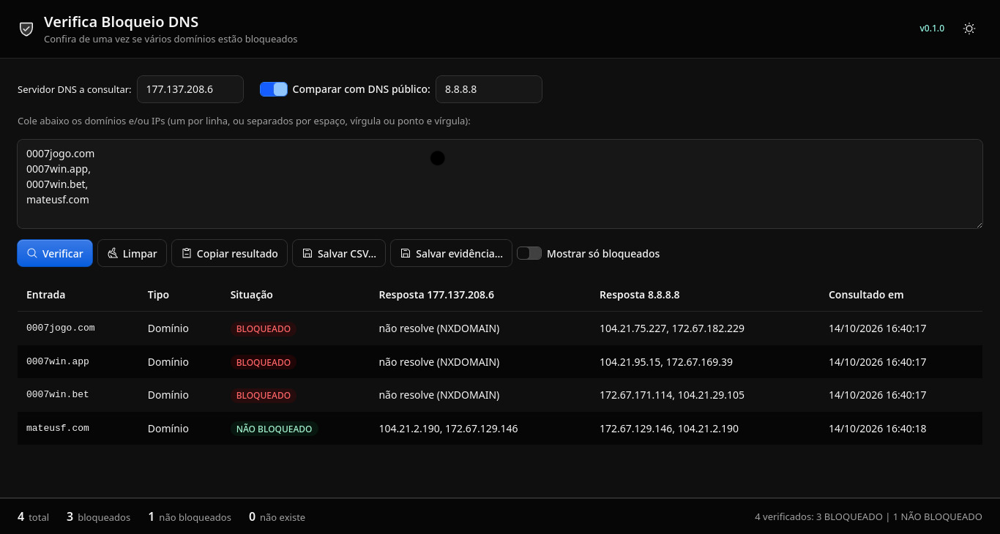

<div align="center">

# Check DNS Block

[](https://github.com/mateusfg7/check-dns-block/actions/workflows/ci.yml)
[](https://github.com/mateusfg7/check-dns-block/actions/workflows/release.yml)

Cross-platform desktop app that checks whether a list of domains/IPs is blocked on a given
DNS server, by comparing its answers against a reference DNS server.

Built with [Tauri 2](https://tauri.app), Rust, React and [Kumo](https://github.com/cloudflare/kumo).



</div>

## Features

- Paste domains and/or IPs and resolve them against a configurable target DNS and reference DNS
- Classify each result: `BLOQUEADO` / `NÃO BLOQUEADO` / `NÃO EXISTE` / `NÃO RESOLVE` /
  `SEM RESPOSTA`
- Reverse (PTR) lookup for pasted IPs — `REVERSO OK` / `SEM REVERSO`
- "Mostrar só bloqueados" filter to show only blocked entries
- Copy results to the clipboard as TSV, or export a `;`-delimited CSV or a timestamped
  evidence report

## Getting started

```bash
pnpm install
pnpm tauri dev      # launches the desktop app with hot reload
```

See [docs/CONTRIBUTING.md](./docs/CONTRIBUTING.md) for build requirements, the full
development command reference and the project layout.

## Roadmap

- [ ] Command-line mode (`<app> lista.txt [dns]`)

## Contributing

Contributions are welcome! See [docs/CONTRIBUTING.md](./docs/CONTRIBUTING.md) to get set up,
and [docs/RELEASING.md](./docs/RELEASING.md) for how versioning and releases work.
